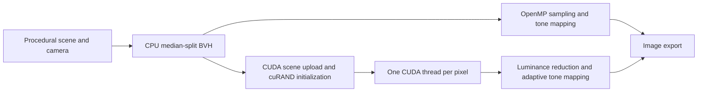
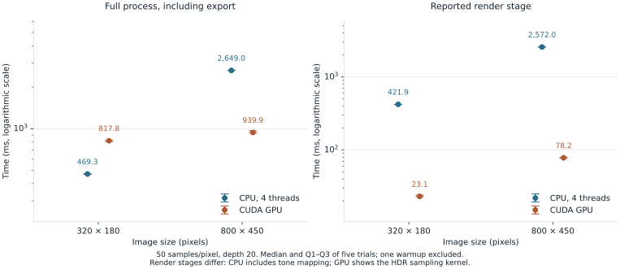

# CUDA Ray Tracer

An offline C++/CUDA path tracer: at **800 × 450 pixels, 50 samples/pixel and depth 20**, median complete-run latency was **939.9 ms on a RTX 4070 Laptop GPU versus 2,649.0 ms on four CPU threads**, a **2.82× ratio of medians** under Ubuntu WSL2. GPU latency had a **35.6 ms IQR**. [Raw observations and environment](bench/results/wsl-2026-09-12-isolated/)

## 2. Abstract

This course project explores how to render a scene with stochastic ray bounces on CPU and GPU.
Each pixel needs many samples, and each sample may traverse several objects and materials.
A CPU-built bounding volume hierarchy (BVH) reduces intersection work; CUDA assigns one thread to each pixel.
The CPU reference uses OpenMP and shares the scene, geometry and material representations.
In five measured runs per configuration, the GPU completed the larger image faster, while the CPU completed the smaller image faster.
The paths use different random generators and tone mapping, so this compares the existing programs, with no claim of equal image quality or pixel equivalence.

## 3. Context and problem

The [course assignment](docs/Sujet.txt) asks for sphere and plane intersections, image export, unit tests, and a comparison of CPU and GPU approaches. The implementation extends this with diffuse, reflective and refractive materials, a perspective camera, and a stylized solar scene.

Testing every object for every ray makes intersection work grow with scene size. The BVH groups objects by their bounds. Rendering still needs irregular traversal and material branches, which makes GPU throughput sensitive to the workload. Launching a new CUDA process also introduces costs that a kernel-only timer does not capture.

## 4. Approach



The current implementation uses enum dispatch for spheres and planes, a median split along the longest BVH axis, and iterative traversal. CUDA kernels render HDR colors, reduce luminance, then apply adaptive tone mapping. The CPU path applies ordinary tone mapping as part of its rendering loop. These choices and their tradeoffs are documented in [design.md](docs/design.md); alternatives are discussed as possibilities, without claiming they were experimentally evaluated.

## 5. Results

One warmup and five measured runs were performed for each mode and size, alternating CPU and GPU. Every invocation starts a new process, initializes the same scene, renders 50 samples/pixel with depth 20, writes a PNG and exits. The table reports the median and interquartile range (IQR), using inclusive quartiles. No observation was discarded beyond the declared warmups.

| Image | Mode | Complete run, median (ms) | IQR (ms) | Reported render stage, median (ms) |
|---|---|---:|---:|---:|
| 320 × 180 | CPU, 4 threads | 469.3 | 4.5 | 421.9 |
| 320 × 180 | CUDA GPU | 817.8 | 14.2 | 23.1 |
| 800 × 450 | CPU, 4 threads | 2,649.0 | 1.7 | 2,572.0 |
| 800 × 450 | CUDA GPU | 939.9 | 35.6 | 78.2 |

The GPU has a shorter reported rendering stage at both sizes. Its complete process is slower at the smaller size. All observations, including slower runs, remain in the [CSV](bench/results/wsl-2026-09-12-isolated/raw.csv) and [individual logs](bench/results/wsl-2026-09-12-isolated/logs/). A [preliminary collection](bench/results/wsl-2026-09-12/README.md) overlapped repository file cleanup and is retained separately; the table above uses the subsequent collection with no competing agent benchmark or local cleanup.

<picture>
  <source media="(prefers-color-scheme: dark)" srcset="docs/assets/bench-dark.svg">
  
</picture>

The render-stage columns cover different work: CPU includes tone mapping, while GPU measures the HDR sampling kernel only. The complete-run comparison includes each path's actual output processing. See [results.md](docs/results.md) for the full quartiles and measurement limits.

| Environment | Measured configuration |
|---|---|
| CPU | Intel Core i9-13900H; WSL exposes 20 logical CPUs and reports 10 cores |
| CPU workers | `OMP_NUM_THREADS=4`, `OMP_DYNAMIC=FALSE` |
| GPU | NVIDIA GeForce RTX 4070 Laptop GPU; compute capability 8.9; 8,188 MiB reported VRAM |
| Memory available to WSL | 16,537,268,224 bytes total RAM reported by `free -b` |
| System | Ubuntu 24.04.4 LTS, WSL2 kernel 6.6.87.2 |
| Toolchain | CMake 3.28.3; GCC 13.3.0 for C++ tests/CPU-only build; nvcc 12.0.140 with packaged GCC 12 host wrapper; NVIDIA driver 616.56 |
| Build | C++17, Release, `-O3 -DNDEBUG`, CUDA architecture 89, `ENABLE_FAST_MATH=ON`; both benchmark modes use the same CUDA-built executable |
| Dependencies | GoogleTest 1.14.0; cuRAND and Thrust from the CUDA toolkit; vendored stb headers; Python 3.12.3 and Matplotlib 3.10.7 for figures |

The [environment manifest](bench/results/wsl-2026-09-12-isolated/environment.json) records the commands, source fingerprint, executable fingerprint and measured commit. Physical host topology and WSL topology should not be treated as interchangeable.

## 6. What works

- The CPU-only executable builds and produces an image without requiring CUDA. The [build and smoke logs](bench/results/validation/) record the repaired build.
- **210 CPU tests pass**, covering vectors, intersections, camera setup, materials, tone mapping, BVH behavior and random sampling. [CPU test output](bench/results/validation/cpu-tests.log)
- **8 GPU tests pass** on the local NVIDIA GPU, exercising random-state initialization, luminance reduction, tone mapping and constant-memory transfers. [GPU test output](bench/results/validation/gpu-tests.log)
- Both rendering paths complete all benchmark invocations and produce PNG files with the requested dimensions. Each [raw observation](bench/results/wsl-2026-09-12-isolated/raw.csv) includes its exit code, PNG digest and log path.

## 7. What does not work

The built-in `--benchmark` changes render dimensions without reinitializing the camera. Its rows therefore do not show the same framing. The committed protocol invokes ordinary rendering separately for each size; fixing the built-in mode is future renderer work.

The CPU-only entry point parses but ignores `--profile`, `--info` and `--benchmark`. The CUDA executable supports profiling in its CPU path, which is why both benchmark modes use that executable. The CPU-only timing display is less precise and is not used for the headline comparison.

Unknown command-line options are silently ignored, and numeric arguments are not checked for valid ranges. Export failures are not propagated as process failures. Use positive dimensions and samples, and an existing writable output directory. The benchmark harness checks that a PNG was actually created, but the CLI itself still needs validation and explicit error reporting.

There is no JSON scene loader, interactive viewer, triangle/box geometry, volumetric material or Russian Roulette in the current renderer. Older documents and generated API pages described some of these features. Those pages were removed; the [historical report notice](rapport/README.md) explains how to read the retained coursework files.

The CUDA install rule refers to a missing `scenes/` directory. Use the build-tree executable; installation packaging is not validated. Slurm examples require site-specific configuration and some use unsupported options. HPC execution is **non mesuré**: no cluster job was run for this report.

## 8. Limits and scope

The benchmark covers one procedural scene and two image sizes on one laptop under WSL2. It measures neither image quality nor convergence against a reference renderer. GPU seeds depend on `time(NULL)`; CPU row seeds are fixed, and there is no common seed option. CPU and GPU tone mapping differ. Fast-math compilation is enabled.

The printed `MRays/s` value counts primary samples (`width × height × samples`), not every bounce ray. No ray-throughput claim is made here. The old RTX 4060 and GH200 tables lack committed raw observations and are not carried into current results. CI is configured for Ubuntu CPU build/tests; hosted CI execution is pending the first publication of this branch. GPU coverage here is local, with the logs linked above.

## 9. Reproducibility

Use Linux or WSL2 with a C++17 compiler, CMake, OpenMP, Git and Python. The GPU run additionally needs a compatible NVIDIA GPU, driver and CUDA toolkit. Install the plotting dependency in a virtual environment:

```bash
git clone https://github.com/Gotman08/RayTracing.git
cd RayTracing
git switch chore/repo-overhaul
python3 -m venv .venv
source .venv/bin/activate
python3 -m pip install -r bench/requirements.txt
CUDA_ARCH=89 OMP_NUM_THREADS=4 RT_RESULTS_DIR=bench/results/local-run bash bench/run.sh
python3 bench/plot.py bench/results/local-run
```

The branch becomes fetchable when this prepared change is published. Substitute the architecture of your GPU for `89`. The script performs one warmup plus five measured runs at each size, writes CSV/JSON and individual logs, then regenerates both SVG themes. It refuses to overwrite an existing result CSV. CPU-only systems can set `RT_MODE=cpu` and omit `CUDA_ARCH`; those results do not reproduce the CPU-via-CUDA-binary comparison above.

Regenerate the checked-in figure without rerunning measurements:

```bash
python3 bench/plot.py bench/results/wsl-2026-09-12-isolated
```

GoogleTest is pinned to 1.14.0 and downloaded at configure time. The CUDA toolkit supplies cuRAND/Thrust; headers for image export are already present. The source fingerprint in the manifest covers `src/`, `include/`, `external/` and `CMakeLists.txt`. Logs normalize the local checkout prefix to `<repo>`; observations are otherwise retained.

## 10. Installation and usage

CPU-only build and tests:

```bash
cmake -S . -B build_cpu -DCMAKE_BUILD_TYPE=Release -DBUILD_CPU_ONLY=ON -DBUILD_TESTS=ON
cmake --build build_cpu --parallel 4
ctest --test-dir build_cpu --output-on-failure
OMP_NUM_THREADS=4 ./build_cpu/raytracer -w 800 -h 450 -s 50 -d 20 -o output/example.png
```

CUDA build and tests for the measured GPU:

```bash
cmake -S . -B build_gpu -DCMAKE_BUILD_TYPE=Release -DCMAKE_CUDA_ARCHITECTURES=89 -DBUILD_TESTS=ON
cmake --build build_gpu --parallel 4
ctest --test-dir build_gpu --output-on-failure
./build_gpu/raytracer --info
./build_gpu/raytracer -w 800 -h 450 -s 50 -d 20 --profile -o output/example.png
./build_gpu/raytracer --help
```

Use `--cpu` on the CUDA executable for its OpenMP path. Output extension selects PNG, JPG, BMP or TGA; use `.ppm` for text PPM output. Native Windows/MSVC builds were not validated.

## 11. Repository structure

```text
include/raytracer/  Geometry, materials, camera, BVH and render kernels
src/               CUDA/CPU entry points, command line, scene and export
tests/             CPU and GPU GoogleTest cases
bench/             Measurement runner, plot generator and committed observations
docs/              Design, results, generated figures and course context
rapport/           Historical report sources with a provenance notice
scripts/slurm/     Historical cluster job examples requiring adaptation
external/          Vendored stb headers and their license notices
.github/workflows/ Ubuntu CPU build, tests and image smoke check
```

To regenerate local API documentation, run `doxygen Doxyfile` and open `docs/html/index.html`. Generated pages are ignored rather than committed.

## 12. Possible next steps

1. Validate CLI inputs and image-writing failures so automation can trust exit codes.
2. Reinitialize the camera in the built-in benchmark and add a common configurable seed before image-quality comparisons.
3. Align CPU/GPU post-processing and compare error against a high-sample reference image.
4. Evaluate a larger scene sweep and isolate startup, transfer and steady-state costs before tuning the BVH or kernels.
5. Restore installation packaging and validate cluster scripts on the actual target site.

## 13. References

- [Ray Tracing in One Weekend](https://raytracing.github.io/books/RayTracingInOneWeekend.html): background on stochastic ray tracing, geometry and materials.
- [NVIDIA CUDA C++ Programming Guide](https://docs.nvidia.com/cuda/cuda-c-programming-guide/): the execution and memory model used by the GPU path.
- [GoogleTest documentation](https://google.github.io/googletest/): the test framework used by this repository.

## 14. License

[MIT](LICENSE). The existing copyright notice is retained. Vendored stb headers retain their own MIT/public-domain license notices.
